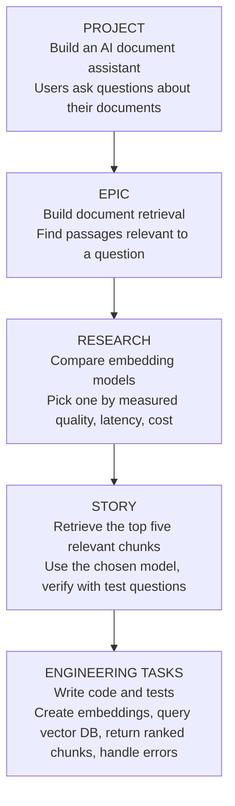

## 1. What every project needs first

Before picking any technology, pin down four things:

- **MVP** (Minimum Viable Product)
- **Functional use cases**: what the system must do
- **KPIs or objectives**: how you'll know it worked
- **Non-functional use cases**: scalability, latency, security, and explainability

> [!definition] MVP (Minimum Viable Product)
> The smallest version of the product that still delivers real value to users, so you can ship it, learn from it, and improve it.

> [!note] Why explainability matters
> Explainability is especially needed for non-business users. When a bug appears, the user should be able to understand what happened.

> [!tip] Rule of thumb
> Don't start from technology. Start from the business.

### Real-world example: Marketing automation with AI and agents

The project is a recommendation-system engine combined with AI.

| Area                     | Items                                                    |
| ------------------------ | -------------------------------------------------------- |
| Functional use cases     | Homepage / products page personalization, feature stores |
|                          | Next best actions                                        |
|                          | New users (cold start)                                   |
|                          | Agent marketing                                          |
| KPIs / objectives        | Increase sales                                           |
|                          | Increase CSAT (customer satisfaction) to 70%             |
|                          | Feedback loop                                            |
| Non-functional use cases | Latency: real time, near real time, batch                |
|                          | Scalability (number of use cases, peak campaigns)        |

> [!definition] Cold start
> The problem of recommending things to a new user the system has no history for yet.

## 2. Architecture frameworks

### TOGAF

TOGAF splits architecture into four layers:

| Layer | Covers |
|---|---|
| Business architecture | Business, organization, people |
| Application architecture | Services |
| Data architecture | Data and information |
| Technology architecture | Hardware, software, network |

### C4 framework (overview)

| Level | What it shows | Audience |
|---|---|---|
| **1. System Context** | The big picture: the system you're building, its users, and the external systems or third-party services it talks to. | Technical and non-technical stakeholders (managers, product owners, executives) |
| **2. Container** | The high-level building blocks inside the system (web apps, mobile apps, databases, microservices, message queues), how they communicate, and which technologies they use. | Architects and developers |
| **3. Component** | The internal modules, controllers, repositories, or building blocks inside one container. | Engineers working on that service |
| **4. Code** | Implementation details like classes, interfaces, or database schemas, often generated by IDEs. | Developers. Usually optional, since code changes too fast to maintain these by hand. |

> [!warning] "Container" isn't Docker
> In C4, a container is an executable application or a data store. It isn't necessarily a Docker container.

The full walkthrough of each level is in [section 6](#6-the-c4-model-in-detail).

## 3. Architecture and Agile

> [!definition] Architecture
> How to design a system: decide which components it needs and define how they work together.

> [!definition] Agile
> How to break the work into small pieces, build them step by step, test the results, and improve the system over time.

You start with the big goal and divide it into major features. Then you break those features into small tasks, and research anything you don't yet know how to build.

![[Pasted image 20261019232515.png]]

## 4. The four planning levels

### 4.1 Project level: what are we building and why?

A project is the complete product or system you want to deliver. It defines the goal, the users, the main requirements, and the boundaries of the work.

**Example: AI document assistant.** Users upload PDFs and ask questions about their contents. At the project level you define:

| Item | For this project |
|---|---|
| Goal | An AI assistant that answers questions using uploaded documents |
| Users | Students, researchers, or company employees |
| Main features | Document upload, question answering, source citations, user authentication |
| Architecture | Frontend, backend API, database, file storage, retrieval system, LLM (large language model) |
| Constraints | Budget, response speed, security, accuracy |
| Success criteria | Answers are relevant, cite the correct sources, and keep each user's documents private |

![[Pasted image 20261019235015.png]]

### 4.2 Epic level: major system capabilities

**Main question:** What major capabilities must we build to reach the project goal?

> [!definition] Epic
> A large body of work that delivers one meaningful capability. It usually contains several smaller stories.

For the AI document assistant, the epics could be:

![[Pasted image 20261019235038.png]]

Each epic should have:

- A clear objective
- A defined scope
- A way to measure success
- A list of the stories needed to deliver it
- Its dependencies on other epics, if any

For example, the question-answering epic depends on having document content and a retrieval mechanism available.

> [!tip] As an AI engineer
> Think in capabilities, not code files. "Build the embedding function" is an implementation task. "Allow users to retrieve relevant document passages" describes a capability.

### 4.3 Story level: small, deliverable pieces of work

**Main question:** What specific behavior should the system deliver?

> [!definition] Story
> A small, testable piece of functionality that contributes to an epic. Stories are often written from the user's point of view, but technical stories are common too.

Here's the **Document ingestion** epic broken into stories.

**Story 1: Upload a PDF.** As a user, I want to upload a PDF so that I can ask questions about its content.

- Accept supported PDF files.
- Reject files that exceed the size limit.
- Return a clear error for invalid files.

**Story 2: Extract document text.** As a system, I need to extract text from uploaded PDFs so the content can be searched.

- Extract text from supported PDFs.
- Detect empty or unreadable documents.
- Report extraction failures without crashing the service.

**Story 3: Split text into chunks.** As a retrieval system, I need document text divided into suitable chunks so relevant passages can be retrieved.

- Split long text into manageable chunks.
- Keep document and page metadata where available.
- Handle short documents and empty text correctly.

> [!definition] Acceptance criteria
> Specific conditions that must be met for a story to count as complete. You define them **before** implementation. The bullets under each story above are its acceptance criteria.

A story can be broken into engineering tasks:

| Story | Example implementation tasks |
|---|---|
| Upload a PDF | Create API endpoint, validate file type, store file, write tests |
| Extract text | Select parser, implement extraction, handle errors, test scanned PDFs |
| Split text | Choose chunking strategy, implement chunker, preserve metadata, test edge cases |

A story isn't the same as a single task. One story may need several tasks and multiple code changes.

> [!tip] As an AI engineer
> Keep stories small enough to implement and verify. For AI features, add measurable quality checks where you can. "Improve retrieval" is vague. "Retrieve a relevant passage for at least 8 of 10 defined test questions" is testable, assuming that threshold suits your project.

### 4.4 Research level: investigating unknowns

**Main question:** What do we need to learn or verify before choosing an approach?

Research matters a lot in AI engineering, because the best technical choice often depends on data quality, model behavior, evaluation results, latency, and cost.

> [!definition] Spike
> The Agile name for a research item: a time-boxed investigation meant to reduce uncertainty.

For example, before building retrieval you might not know which embedding model works best on your documents.

**Research spike: Choose an embedding model**

*Question:* Which embedding model retrieves the most relevant passages for our document collection at an acceptable cost?

*Research plan:*

1. Prepare a representative set of documents and test questions.
2. Choose two or three candidate embedding models.
3. Generate embeddings and retrieve the top five passages for each question.
4. Measure retrieval quality, latency, and cost.
5. Compare the results and write up the recommendation.

*Expected output:* a short report covering

- what was tested,
- what the measurements showed,
- the limits of the experiment,
- which model you recommend and why,
- what still needs testing.

**Research vs implementation**

| Research | Implementation |
|---|---|
| Determine which chunk size works best | Implement the chosen chunking strategy |
| Compare vector databases | Configure and integrate the selected database |
| Test whether an LLM can return reliable citations | Build citation formatting and validation |
| Investigate whether scanned PDFs need OCR | Add an OCR pipeline if the evidence supports it |

> [!definition] OCR (optical character recognition)
> Converting text in images or scanned pages into machine-readable text.

> [!note] Research isn't a fixed stage
> Research doesn't have to come after stories. It can happen before a project starts, while defining an epic, or mid-implementation when a technical question comes up. Its output should help the team make a decision, not turn into an endless investigation.

### 4.5 How the levels work together

Here's one feature followed from idea to working code:



The project describes the goal, the epic describes the capability, research reduces uncertainty, and the story describes a deliverable behavior.

### 4.6 Where architecture fits

Architecture isn't a separate Agile level. It's the set of design decisions made across the whole project.

| Level | Architecture work |
|---|---|
| Project | Define the major components and how data flows between them |
| Epic | Design how a major capability works and connects to other components |
| Story | Decide implementation details, interfaces, error handling, and tests |
| Research | Test uncertain design choices before committing to them |

For example: at the project level you might decide to use a vector database. At the epic level you define how retrieval works. At the story level you define the API contract and retrieval behavior. Research tells you whether the chosen database and embedding model actually meet the requirements.

You don't need to finalize every architectural decision up front. Set the important boundaries early, then refine as you learn.

## 5. Agile vs C4

| Approach | Difficulty to start | Best use |
|---|---|---|
| Agile: Project/Epic/Story | Easy | Plan and deliver features |
| C4 | Easy | Understand and document software architecture |

- **Agile** tells you what to build next.
- **C4** tells you how the software fits together.
- **Research** tells you what you need to find out before committing to a decision.

> [!tip] You rarely need all four C4 levels
> C4 is deliberately lightweight. Its official guidance says Context and Container diagrams are enough for many teams.

## 6. The C4 model in detail

> [!definition] C4 model
> A simple way to visualize and explain software architecture, moving from the big picture of a system down to the details of its code. The name comes from its four levels.

1. **Context**: who uses your system, and what does it connect to?
2. **Containers**: what are the main applications, services, and data stores?
3. **Components**: what are the main building blocks inside one application?
4. **Code**: how is a specific component implemented?

![[Pasted image 20261020004712.png]]

Think of it like a map:

| C4 level | Map analogy |
|---|---|
| Context | The whole city and its connections to neighboring cities |
| Containers | The main districts and facilities |
| Components | The important buildings inside one district |
| Code | The rooms and internal details of one building |

### 6.1 C1: System Context (see the whole system)

**Question:** Who uses the system, and what does it depend on?

At this level your whole AI application is one box. You don't show how it works inside yet. For our RAG application, the diagram might look like this:

![[Pasted image 20261020004805.png]]

This is a simplified illustration. In a proper C4 diagram, label the connections to external systems explicitly, such as "sends prompts to" or "sends email notifications through."

Notice what's missing:

- No FastAPI endpoints
- No PostgreSQL tables
- No embedding functions
- No internal services

That's on purpose. Someone should understand the purpose and boundaries of the system without needing to understand its code.

**When to draw it:** at the start of a project, when explaining the system to a teammate, or when deciding which external services the product needs.

### 6.2 C2: Container diagram (see the main building blocks)

**Question:** What applications and data stores make up the system, and how do they communicate?

> [!definition] Container (C4)
> A separately runnable or deployable application, or a data store. Not necessarily a Docker container.

Now we open the AI Document Assistant box and look inside.

![[Pasted image 20261020005013.png]]

The connections matter as much as the boxes:

- The frontend sends requests to the backend API over HTTPS.
- The API stores uploaded PDFs in object storage.
- The API submits processing jobs to the queue.
- The worker reads jobs, extracts text, creates embeddings, and saves the results.
- When a user asks a question, the API retrieves relevant chunks and calls the LLM.

The diagram is illustrative, not a final spec. A real design should show the actual connections and technologies you plan to use.

**Why C2 matters for AI engineers:** many AI application problems aren't model problems. For example:

- A request times out while a large PDF is processing.
- Two workers process the same document.
- A user retrieves another user's document chunks.
- The embedding API is down.
- The queue fills up with failed jobs.

A C2 diagram shows where these problems could happen and which parts of the system need reliability, security, or performance controls.

**When to draw it:** when starting a substantial application, adding a background worker, introducing a database or queue, or deciding whether a new service is needed.

### 6.3 C3: Component diagram (see inside one application)

**Question:** What are the main responsibilities inside one container, and how do they work together?

Now zoom into just the **Backend API** from C2. Skip the frontend, the worker internals, and every database table. Focus on the inside of this one application.

![[Pasted image 20261020005317.png]]

The responsibilities inside the API:

| Component | Responsibility |
|---|---|
| API routes | Receive requests and call the right services |
| Authentication | Verify who the user is and whether they can access a resource |
| Document service | Manage document-related operations |
| Retrieval service | Find the most relevant chunks for a question |
| Answer service | Build the LLM request and return the generated answer |

For example, when a user asks "What does my document say about neural networks?", the route calls the answer service. The answer service uses the retrieval service to fetch relevant chunks, then sends the question and context to the LLM.

> [!definition] Component
> A meaningful building block inside an application: a module, a service, or a group of related classes.

In Python, the implementation might look like this:

```text
app/
├── api/
│   ├── documents.py
│   └── chat.py
├── services/
│   ├── document_service.py
│   ├── retrieval_service.py
│   └── answer_service.py
├── security/
│   └── auth.py
└── main.py
```

These files are one way to implement the components. C4 doesn't require this layout.

> [!warning] Don't diagram every file
> Turning every Python file or function into a component makes the diagram noisy. Show the major responsibilities and how they relate.

**When to draw it:** when a container gets complicated, during a design review, or when developers need to understand how one application is organized.

### 6.4 C4: Code diagram (see the implementation details)

**Question:** How is a particular component implemented?

At this level you go from components down to classes, interfaces, functions, and how they relate. Let's zoom into the **Retrieval Service**. Imagine it contains these classes:

![[Pasted image 20261020005342.png]]

A possible Python implementation:

```python
class RetrievalService:
    def __init__(self, embedder, vector_repository):
        self.embedder = embedder
        self.vector_repository = vector_repository

    async def retrieve(self, question, tenant_id, limit=5):
        vector = await self.embedder.embed(question)
        return await self.vector_repository.search(
            vector=vector,
            tenant_id=tenant_id,
            limit=limit,
        )
```

This code is the implementation. A C4 Code diagram would show the same types and their relationships visually.

> [!warning] Passing `tenant_id` isn't isolation
> In a multi-tenant system, the repository has to actually enforce the `tenant_id` filter. Just passing the parameter doesn't guarantee one user can't see another's data.

## 7. Using these as an architecture starting point

1. Problem statement / pain points
2. Goals and non-goals, solution assumptions
3. As-is architecture; explore the enterprise architecture
4. Architecture principles, key decisions, and trade-offs
5. Assessment
6. Priorities
