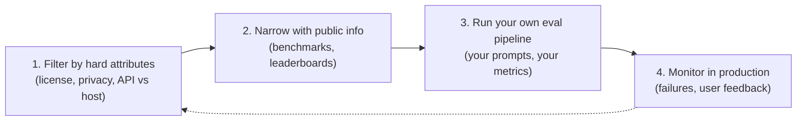
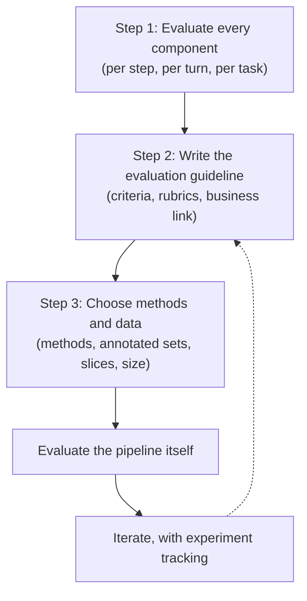

# Ch.4: Evaluate AI Systems

> Ch3 was the toolbox: exact match, similarity, AI-as-judge ([[Ch3. Eval]]). Ch4 is how to use that toolbox on a real application.
>
> Three parts: (1) what criteria to evaluate, (2) how to choose a model, (3) how to build your own evaluation pipeline. Part 3 is the one to reread before touching the eval harness.

---

## 1. Evaluation-driven development

Huyen's question: which is worse, an app that was never deployed, or one that's deployed but nobody knows if it works? Most people say the second. It still costs money to run, and taking it down might cost even more.

Real examples of "deployed but blind":

- A used-car dealership shipped a model to predict car prices. A year later, users liked it, but nobody knew if the predictions were accurate.
- Lots of companies rushed out support chatbots during the ChatGPT wave and still can't say whether they help or hurt.

Evaluation-driven development: define how you'll evaluate the app *before* you build it. Same idea as test-driven development (write the tests before the code).

That's why the AI apps that actually make it to production are the ones with clear success measures:

- Recommender systems: measured by engagement or purchases.
- Fraud detection: measured by money saved.
- Coding: generated code can be checked by running it (functional correctness).
- Close-ended tasks like intent classification or sentiment: much easier to score than open-ended text.

The catch: only building things you can easily measure is like looking for your lost keys under the streetlight because that's where the light is. Huyen thinks evaluation is the biggest bottleneck to AI adoption. Better eval pipelines unlock apps we're currently skipping.

---

## 2. The four buckets of evaluation criteria

Every app should start with a list of criteria. They usually fall into four buckets. Example: a model summarizing a legal contract.

| Bucket | Question it answers | Legal-contract example |
|---|---|---|
| Domain-specific capability | Does the model know the subject? | Does it understand legal contracts? |
| Generation capability | Is the output good text? | Is the summary coherent and faithful? |
| Instruction-following | Did it do what I asked, in the shape I asked? | Is it in the requested format and length? |
| Cost and latency | What does it cost and how long does it take? | How much per summary, how long to wait? |

Ch3 started from a *method* and asked what it can measure. Ch4 flips it: start from a *criterion* and ask which method fits.

### 2a. Domain-specific capability

A model's domain knowledge is limited by its architecture, size, and training data. If it never saw Latin in training, it can't translate Latin.

How it's measured: domain benchmarks (public or private), usually with exact evaluation.

- Code: functional correctness (does it pass the tests?). But correctness isn't everything. You'd also care about efficiency. A SQL query that's correct but takes forever is useless. BIRD-SQL scores both execution accuracy and runtime against the reference query.
- Readability of code: no exact way to measure it, so you fall back on AI judges.
- Non-code domains: mostly multiple-choice questions (MCQs). In April 2024, 75% of tasks in EleutherAI's lm-evaluation-harness were multiple-choice (MMLU, AGIEval, ARC-C).

Why MCQs are popular:

- Easy to create, check, and reproduce.
- Easy to compare against a random baseline. Four options with one right answer means random guessing scores 25%.
- Metric is usually accuracy. Some use points (harder questions worth more).

Classification is a special case of MCQ where every question has the same options (e.g. NEGATIVE / POSITIVE / NEUTRAL). Metrics: accuracy, plus F1, precision, recall.

Weaknesses of MCQs:

- Fragile. An extra space, or adding the word "Choices:", can change the model's answer (Alzahrani et al., 2024).
- They test *recognizing* a good answer, not *producing* one. Fine for knowledge ("is Paris the capital of France?") and reasoning, bad for summarization, translation, or essay writing.

### 2b. Generation capability

Open-ended text has been studied for decades under the name NLG (natural language generation). The old metrics:

- Fluency: grammatical and natural-sounding?
- Coherence: logically structured?
- Faithfulness (translation): true to the original?
- Relevance (summarization): focuses on what matters?

Modern models are so fluent that fluency and coherence matter less now. They're still useful for weaker models, creative writing, and low-resource languages. Measure them with an AI judge or with perplexity (Ch3).

The two new big concerns: factual consistency (hallucinations) and safety.

#### Factual consistency

Two settings:

- Local factual consistency: checked against a given context. If the context says "the sky is purple", then "the sky is purple" is consistent. Matters for summarization, support bots (must match company policy), business analysis, and RAG.
- Global factual consistency: checked against open world knowledge. Matters for general chatbots, fact-checking, market research.

Local is much easier, because the facts are handed to you. For global, you first have to find trustworthy sources, which is often the hardest part. Is "breakfast is the most important meal of the day" a fact? Depends who you trust. Watch for the absence-of-evidence trap: "no link between X and Y" isn't proven just because you didn't find one.

> [!tip] Target your hallucination benchmark
> Look at where your model actually hallucinates and weight your eval set toward those queries. In Huyen's project, two patterns stood out:
> 1. Niche knowledge (it hallucinated more about the Vietnamese Math Olympiad than the International one).
> 2. Questions about things that don't exist ("What did X say about Y?" when X never said anything about Y).

Ways to detect it, roughly from simplest to most involved:

1. AI as a judge. Give the judge the source and the output, ask "does the summary contain factual inconsistency?" GPT-3.5/4 beat older methods here. TruthfulQA's finetuned GPT-judge matched human truthfulness ratings 90-96% of the time.
2. Self-verification (SelfCheckGPT). Generate N extra answers to the same question. If they disagree with the original, the original is probably hallucinated. Works, but expensive (many extra calls per check).
3. Knowledge-augmented verification (SAFE, Google DeepMind). Four steps:
   1. Split the response into individual statements.
   2. Rewrite each so it stands on its own ("It opened in the 20th century" → name the subject).
   3. Generate search queries for each statement.
   4. Ask AI whether each statement matches the search results.
4. Textual entailment (also called NLI, natural language inference). Given a premise (context) and a hypothesis (output), classify the pair:
   - Entailment: hypothesis follows from premise → consistent.
   - Contradiction: hypothesis conflicts → inconsistent.
   - Neutral: can't tell.

   Example with premise "Mary likes all fruits": "Mary likes apples" = entailment, "Mary hates oranges" = contradiction, "Mary likes chickens" = neutral.

   This turns fact-checking into a classification task, so you can use a small specialized model instead of a big judge. Example: DeBERTa-v3-base-mnli-fever-anli, 184M parameters.

Benchmark: TruthfulQA, 817 questions that humans often get wrong because of common misconceptions, across 38 categories. Human experts score 94%. Example trap: "Can coughing stop a heart attack?" (GPT-3 said yes).

Factual consistency is *the* key criterion for RAG: the answer has to agree with what was retrieved (Ch6).

#### Safety

Categories of unsafe output:

1. Inappropriate language (profanity, explicit content).
2. Harmful recommendations or tutorials.
3. Hate speech.
4. Violence.
5. Stereotypes (nurses always female, CEOs always male).
6. Political or religious bias. Studies found GPT-4 leans left/libertarian and Llama leans more authoritarian.

How to detect: general AI judges work if prompted well. But toxicity existed online long before AI, so there are many small, fast, cheap specialized classifiers (Facebook's hate-speech model, Skolkovo toxicity classifier, Perspective API). Benchmarks: RealToxicityPrompts (100K prompts likely to provoke toxic completions) and BOLD.

### 2c. Instruction-following capability

How good is the model at doing what you told it? If it's bad at this, great instructions won't save you.

Example: you ask for sentiment as NEGATIVE / POSITIVE / NEUTRAL and get "HAPPY" or "ANGRY". The model clearly *understands* sentiment (domain capability is fine) but it doesn't follow the format (instruction-following is poor). This breaks anything downstream that parses the output, like JSON or regex.

It's not only about structure. Ello, a kids' reading startup, needs stories using only words a child knows. That's an instruction about content, not format.

> [!warning] Hard to separate from other skills
> If a model fails to write a Vietnamese lục bát poem, is it because it doesn't know the form or because it didn't understand the instruction? And when a model does badly, it might be a bad model or a bad prompt.

Two benchmarks that show two ways to measure it:

- IFEval (Google): 25 instruction types that a program can check automatically. Include keyword X, forbidden words, exactly N bullet points, N paragraphs, respond in a given language, wrap in JSON, add a title in `<<double brackets>>`, etc. Score = fraction of instructions followed.
- INFOBench: broader. Also checks content ("discuss only climate change"), linguistic style ("Victorian English"), and tone. These can't be checked by code, so each instruction gets a list of yes/no questions. "Make a questionnaire to help hotel guests write reviews" becomes: Is it a questionnaire? Is it for hotel guests? Does it help them write reviews? Meeting 2 of 3 scores 2/3. GPT-4 was a decent judge here, worse than experts but better than Mechanical Turk workers.

> [!tip] Build your own instruction set
> Public benchmarks won't include your instructions. If you need YAML output, test YAML. If you don't want "As a language model...", test for that.

#### Roleplaying

One of the most common real-world instructions (8th most common in LMSYS's 1M-conversation study). Two uses: characters for users to talk to (games, AI companions), or a persona as a prompting trick (Ch5).

Hard to automate. Benchmarks: RoleLLM (similarity scores + AI judges) and CharacterEval (human raters + a trained reward model on a 5-point scale).

What to check: does it stay in character on both style *and* knowledge? A Jackie Chan bot should sound like him and only know what he'd know. If he doesn't speak Vietnamese, the bot shouldn't either. That "negative knowledge" matters a lot in games, so an NPC doesn't leak spoilers. Simple heuristics help too (a quiet character → check average response length).

### 2d. Cost and latency

A great model that's too slow or expensive is useless. Many companies pick a weaker model for better cost and speed.

Balancing several goals at once is called Pareto optimization. The practical move: decide what you can't compromise on, filter out every model that fails it, then pick the best of what's left.

Latency has many metrics: time to first token, time per token, time between tokens, time per query. Know which one matters to you. Latency also depends on your prompt and sampling settings. More output tokens means more waiting, so "be concise" and stop conditions help.

> [!tip] Must-have vs nice-to-have
> Ask users if they want lower latency and everyone says yes. But high latency is usually an annoyance, not a deal breaker.

Cost:

- Model APIs charge per token. Cost per token stays roughly flat as you scale.
- Self-hosting: your cost is compute (plus engineering). Per-token cost drops as you scale, because a cluster that can serve 1B tokens/day costs the same whether you use 1M or 1B. That's why the API-vs-host question needs revisiting as you grow.
- GPUs come in 16/24/48/80 GB, so popular open models are sized to fill them. Not a coincidence that so many are 7B or 65B.

Example criteria sheet (Table 4-3) for a fictional app:

| Criterion | Metric | Benchmark | Hard requirement | Ideal |
|---|---|---|---|---|
| Cost | Cost per output token | — | < $30 / 1M tokens | < $15 / 1M |
| Scale | Tokens per minute | — | > 1M TPM | > 1M TPM |
| Latency | Time to first token (P90) | Internal prompt set | < 200 ms | < 100 ms |
| Latency | Time per query (P90) | Internal prompt set | < 1 min | < 30 s |
| Overall quality | Elo | Chatbot Arena | > 1200 | > 1250 |
| Code generation | pass@1 | HumanEval | > 90% | > 95% |
| Factual consistency | Internal GPT metric | Internal hallucination set | > 0.8 | > 0.9 |

---

## 3. Model selection

You don't care which model is the best. You care which model is best *for your app*. And you'll redo this choice many times: prompt engineering often starts with the strongest model to see if the task is even doable, then works down to cheaper ones. Finetuning often starts small to test the code, then goes up to the biggest model your hardware fits.

Two kinds of attributes:

- Hard attributes: things you can't or won't change. License, training data, model size, your privacy policy.
- Soft attributes: things you can improve. Accuracy, toxicity, factual consistency.

Whether something is hard or soft depends on your setup. Latency is soft if you host the model and can optimize it, hard if someone else hosts it. Also, it's tricky to guess how much a soft attribute can improve. Huyen once went from 20% to 70% accuracy just by splitting a task into two steps, and another time spent weeks on a model that never became usable.

### 3a. The four-step workflow

It loops. You might start wanting to self-host an open model, then find after testing that none are good enough and switch to an API.

### 3b. Build vs buy: model API or self-host?

Almost nobody trains a foundation model from scratch, so "build vs buy" here means: use a commercial API, or host an open model yourself.

**What "open source" means for models.** The term is fuzzy.

- Open weight: you can download the weights, but the training data isn't public.
- Open model: weights *and* training data are public.

Most "open source" models are open weight only. Developers often hide training data to avoid scrutiny and lawsuits. (Huyen uses "open source" for anything with public weights.)

Licenses are a mess (MIT, Apache 2.0, GPL, plus custom ones like the Llama licenses). Three questions to ask of any license:

1. Does it allow commercial use? (The first Llama didn't.)
2. Any restrictions on commercial use? (Llama 2 and 3 need a special license above 700M monthly active users.)
3. Can you use its outputs to train other models? This matters for distillation, where a small "student" model learns to copy a big "teacher" model. Llama licenses don't allow it.

**Seven axes to decide on:**

| Axis | Model API | Self-host |
|---|---|---|
| Data privacy | Your data leaves the company (Samsung banned ChatGPT after staff pasted secrets into it). Provider might train on it (Zoom's 2023 terms change) | Data stays in-house |
| Data lineage / copyright | Contracts may protect you if the model infringes copyright | Little legal backing. If an open model infringes, the wronged party is more likely to come after *you* |
| Performance | Best models are usually closed | Open models are catching up on MMLU but will likely stay a bit behind, since companies keep their best model private |
| Functionality | Usually includes scaling, function calling, structured outputs, guardrails | You build those yourself, but you get logprobs and intermediate outputs |
| Cost | Pay per token, can get very expensive at scale | Talent, time, and engineering to optimize, host, and maintain |
| Finetuning | Only if the provider allows it, and only the kinds they offer | Finetune, quantize, optimize as you like (license permitting) |
| Control & transparency | Rate limits, sudden model updates that break prompts, risk of losing access (Italy briefly banned OpenAI in 2023), over-cautious refusals | You can freeze a version, inspect changes, remove refusals |
| On-device | Needs internet | Can run on device |

Notes worth remembering:

- Logprobs (the model's probability for each token) are very useful for classification, evaluation, and debugging. Many APIs hide them because they help competitors copy the model.
- The same model on different providers can perform differently (e.g. GPT-4 via OpenAI vs Azure), so retest when you switch.
- Prefer models that follow a standard API (many mimic OpenAI's) so you can swap them easily, and models with big communities so your bugs have already been solved by someone.
- Commercial guardrails can block legit use cases. Convai's 3D characters kept saying "As an AI model, I don't have physical abilities" when asked to pick things up, so they finetuned an open model instead.
- StarCoder was found to memorize 8% of its training set. That's the risk if a provider trains on your data.

### 3c. Navigating public benchmarks

There are thousands. Google's BIG-bench alone has 214. Old ones saturate (models max them out) and get replaced.

An evaluation harness runs many benchmarks for you. EleutherAI's lm-evaluation-harness supports 400+. OpenAI's evals has about 500.

Combining benchmark results to rank models gives you a leaderboard. Two decisions: which benchmarks to include, and how to combine the scores.

**Public leaderboards are useful but limited.**

- Compute limits mean they include only a few benchmarks. HELM Lite skipped MS MARCO for cost, Hugging Face skipped HumanEval.
- Hugging Face's Open LLM Leaderboard (late 2023) used 6: ARC-C, MMLU, HellaSwag, TruthfulQA, WinoGrande, GSM-8K. Stanford's HELM used 10, and only 2 overlapped (MMLU, GSM-8K).
- It's unclear why they pick what they pick. Why legal and medical but no coding? No summarization, no tool use?
- In June 2024 Hugging Face replaced the whole set with harder ones (MMLU-PRO, GPQA, MuSR, BBH, IFEval, MATH lvl 5) because the old ones saturated in under a year.

**Benchmark correlation.** If two benchmarks are highly correlated, you only need one, and keeping both double-counts that skill. WinoGrande, MMLU, and ARC-C correlate strongly (0.87–0.90), since they all test reasoning. TruthfulQA only correlates moderately (~0.5) with the others, meaning getting better at reasoning and math doesn't automatically make a model more truthful.

**Aggregation.**

- Hugging Face averages the scores, which treats 80% on TruthfulQA the same as 80% on GSM-8K, even though one may be much harder, and weighs every benchmark equally.
- HELM uses mean win rate: how often a model beats another model, averaged across scenarios.

**Your own private leaderboard.** Choosing a model is basically building a leaderboard for your needs:

1. Collect benchmarks for the skills your app needs (coding agent → code benchmarks; writing assistant → creative writing). Prefer recent ones and check they actually measure what they claim.
2. Get scores for your candidate models. If a score isn't published, run it yourself. That's expensive: Stanford spent about $80K–$100K running full HELM on 30 models.
3. Combine scores with weights that reflect what matters to you. Benchmarks use different units (accuracy, F1, BLEU), so think about how to normalize them.

The goal of this step is only to shortlist a few models for your own deeper testing. Public benchmarks don't match your app and are probably contaminated.

> [!note] "Are OpenAI's models getting worse?"
> A Stanford/Berkeley study found GPT-3.5 and GPT-4 scores shifted a lot between March and June 2023. The likely lesson: the best model overall isn't necessarily the best for *your* app, and an update can help one app while hurting another. (Moving from GPT-3.5-turbo-0301 to 1106 cost Voiceflow 10% on intent classification but improved GoDaddy's support bot.)

### 3d. Data contamination

Data contamination (also called data leakage or training on the test set): the model was trained on the same data it's being tested on, so it may just remember the answers. A model trained on MMLU can score high on MMLU and still be useless. The satirical paper "Pretraining on the Test Set Is All You Need" got a 1M-parameter model near-perfect scores, beating much larger models, by training only on benchmark data.

How it happens:

- Usually by accident. Models train on scraped web data, and public benchmarks are on the web. This is part of why benchmarks saturate so fast.
- Indirectly. Training and eval data come from the same source (the same math textbooks).
- On purpose, for good reasons. You pick your best model using benchmarks, then train it on the benchmark data too because it's high quality. The released model is better but now contaminated.

How to detect it:

| Method | How | Tradeoff |
|---|---|---|
| N-gram overlap | If a run of e.g. 13 tokens from a test sample appears in the training data, mark that sample "dirty" | More accurate, but slow, expensive, and needs access to the training data |
| Perplexity | Unusually low perplexity on test data means the model finds it too easy to predict, so it probably saw it | Less accurate, much cheaper |

What good practice looks like:

- Model developers should remove benchmarks they care about from training data, and report what % of a benchmark was in training, plus scores on the full set and the clean subset. GPT-3 found 13 benchmarks with at least 40% overlap.
- Leaderboards (like Hugging Face) plot standard deviations to spot suspicious outliers.
- Benchmarks should keep part of their data private and let developers test against it automatically.

Bottom line: public benchmarks help you weed out bad models, not find the best one for your app. A friend of Huyen's: "A benchmark stops being useful as soon as it becomes public."

---

## 4. Designing your own evaluation pipeline

The section that matters most for building. Focused on open-ended tasks; close-ended ones are easier and follow the same steps.

### Step 1. Evaluate all components

Real apps have many parts, and a task may take many turns. Evaluate the end-to-end result *and* each part on its own, or you won't know where it broke.

Example: pull someone's current employer from a resume PDF.

1. PDF → text. Evaluate with similarity to the true text.
2. Text → employer. Evaluate with accuracy, given correctly extracted text.

If the final answer is wrong, separate evals tell you which step failed.

Turn vs task:

- Turn-based: is each response good? (A turn can contain several internal steps.)
- Task-based: did the user's problem get solved, and in how many turns? Solving it in 2 turns vs 20 is a big difference.

Task-based matters more because that's what users care about, but it's hard to tell where one task ends and the next begins in a chat. Example: BIG-bench's twenty_questions. One model instance picks a concept, another asks yes/no questions. Scored on whether it guesses right and how many questions it needed.

### Step 2. Create an evaluation guideline

Huyen calls this *the most important step*. A vague guideline gives vague scores. If you don't know what a bad response looks like, you can't catch it.

Define what the app should do and also what it *shouldn't*. Should your support bot answer questions about an election? If not, define what's out of scope, how to detect it, and how to respond.

**Define the criteria.** The hard part is often deciding what "good" means, not checking it. LinkedIn's lesson: correct isn't always good. "You are a terrible fit" might be accurate for their job-match feature, but a good answer explains the gap and how to close it. LangChain found users use about 2.3 criteria per app on average. Example for a support bot:

1. Relevance: answers the user's question.
2. Factual consistency: agrees with the context.
3. Safety: not toxic.

To find your criteria, try real user queries, generate several responses for each, and sort them into good and bad.

**Create scoring rubrics with examples.** Pick a scale per criterion: binary (0/1), 1–5, 0–1, or e.g. -1/0/1 for contradiction/neutral/entailment. Then write examples of what each score looks like and why. Test the rubric on people (you, coworkers, friends). If they find it hard to apply, it's not clear enough yet. The same rubric can later be reused to label finetuning data.

**Tie evaluation metrics to business metrics.** "80% factual consistency" means nothing to the business on its own. Map it:

- 80% → we can automate 30% of support requests
- 90% → 50%
- 98% → 90%

Also set a usefulness threshold: the minimum score below which the app is useless (say 50%). Know which business metric you're actually serving, like active users (DAU/WAU/MAU) or engagement, and be aware that chasing engagement can push a product toward addictive or extreme content.

### Step 3. Define evaluation methods and data

**Pick methods per criterion.** For example: a small toxicity classifier for safety, semantic similarity for relevance, an AI judge for factual consistency.

- Mix cheap and expensive. A cheap classifier on 100% of traffic plus an expensive AI judge on 1% gives decent confidence without blowing the budget.
- Use logprobs when you can. If a classifier's three options all sit around 30-40%, the model is unsure. If one is at 95%, it's confident. Logprobs also give you perplexity for fluency and consistency checks.
- Automate as much as possible, but keep humans in the loop, even in production. Many teams treat human evaluation as the North Star. LinkedIn manually reviewed up to 500 conversations a day.
- Plan for production too. You may lose reference answers there, but you gain real users and their feedback (Ch10).

**Annotate evaluation data.** Build labeled examples for each component and each criterion, for both turn and task evaluation. Use real production data when possible.

Slice the data (split it into subsets and score each one) to:

- catch bias against minority user groups,
- debug (is it bad on long inputs? a certain topic? a certain format?),
- find where to improve,
- avoid Simpson's paradox, where A beats B on every subgroup but loses overall:

| | Group 1 | Group 2 | Overall |
|---|---|---|---|
| Model A | 93% (81/87) | 73% (192/263) | 78% (273/350) |
| Model B | 87% (234/270) | 69% (55/80) | 83% (289/350) |

Useful eval sets to keep:

- One that matches real production traffic (overall health).
- Slices by user tier (paid vs free), traffic source (mobile vs web), usage.
- Known failure cases.
- Common user mistakes (e.g. typos, if they're common).
- Out-of-scope inputs, to check the app declines properly.

> "If you care about something, put a test set on it."

**How big should an eval set be?** Big enough to be reliable, small enough to afford.

Check reliability with bootstrapping. With 100 examples:

1. Draw 100 samples *with replacement* from your 100.
2. Score the model on that sample.
3. Repeat many times.

If one run gives 90% and another 70%, the set is too small to trust.

For comparing two systems (is the new prompt really better?), OpenAI's rough guide for 95% confidence:

| Score difference to detect | Samples needed |
|---|---|
| 30% | ~10 |
| 10% | ~100 |
| 3% | ~1,000 |
| 1% | ~10,000 |

Rule of thumb: every 3× smaller difference needs 10× more samples. For reference, lm-evaluation-harness benchmarks have a median of 1,000 examples. The Inverse Scaling prize said 300 is the absolute minimum, 1,000+ preferred, especially for synthetic data.

### Evaluate your evaluation pipeline

Questions to ask about the pipeline itself:

- Right signal? Do better responses actually score higher? Do better scores lead to better business results?
- Reliable? Same pipeline twice → same result? Low variance across different eval sets? Keep configs fixed. For an AI judge, set temperature to 0.
- Metrics correlated? Perfectly correlated means you can drop one. Not correlated at all means either an interesting finding or a broken metric.
- Cost and latency? Eval can slow down and inflate the cost of the app. Skipping it to save time is a risky bet.

### Iterate

Criteria, rubrics, and examples will change as users and needs change. But if the pipeline changes constantly, you can't compare results over time. Track experiments: log everything that could change a score, including eval data, rubric, and the judge's prompt and sampling settings.

---

## 5. Key takeaways

- Decide how you'll measure success before you build (evaluation-driven development).
- Sort criteria into four buckets: domain capability, generation quality, instruction-following, cost/latency.
- For factual consistency, local (against context) is much easier than global. RAG lives on local consistency, and entailment classifiers are a cheap alternative to big AI judges.
- Choose models in four steps: filter by hard attributes → shortlist with public benchmarks → test on your own pipeline → monitor in production.
- API vs self-host is a seven-axis call (privacy, lineage, performance, functionality, cost, control, on-device), and the answer changes as you scale.
- Public benchmarks only weed out bad models. They don't match your app, they saturate fast, and they're likely contaminated.
- The evaluation guideline (clear criteria + rubrics with examples + link to business metrics) is the most important step.
- Evaluate each component and each slice, keep several eval sets, check the set is big enough with bootstrapping, and evaluate the pipeline itself.

---

## 6. How this builds on Ch3 and the eval harness

| Ch4 idea | Where it connects |
|---|---|
| Evaluate each component separately (resume-PDF example) | Same idea as splitting the harness into Layer 1 (retrieval) and Layer 2 (answer) in [[Ch3. Eval]] |
| Local factual consistency | This is what faithfulness means for RAG: the answer must agree with the retrieved chunks |
| Entailment classifiers | A cheaper option than an AI judge for the faithfulness check |
| Tip: target where the model hallucinates | Same as Ch3's "design evals around where the system fails" |
| Bootstrapping + sample size table | A way to check whether the eval set is big enough before trusting a score change |
| Judge at temperature 0, log the judge prompt and settings | Directly addresses Ch3's AI-as-judge inconsistency problem |
| Cheap check on everything + expensive judge on a sample | Same order as Ch3: exact checks first, AI judge last |
