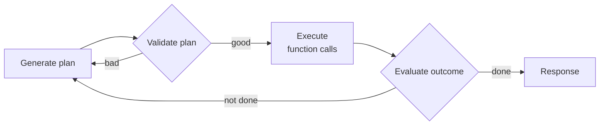

There are two main patterns for **context construction**, meaning how you build the context the model sees for each query:

- **RAG** lets the model retrieve relevant information from external data sources.
- **Agents** let the model use tools, such as web search or news APIs, to gather information and act.

---

## 1. RAG

> [!definition] RAG (Retrieval-Augmented Generation)
> A technique that builds context specific to each query, instead of using the same context for every query. It gives the model the information it needs to handle that particular input.

The success of a RAG system depends on the quality of its **retriever**.

A retriever has two main jobs:

| Job | What it does |
|---|---|
| **Indexing** | Processes data so it can be retrieved quickly later. How you index depends on how you want to retrieve. |
| **Querying** | Ranks chunks or documents by how relevant they are to a given query. |

Retrieval algorithms differ in how they compute those relevance scores. The two common ones are **term-based** and **embedding-based** retrieval.

### 1.1 Sparse vs dense retrieval

> [!definition] Sparse vector
> A vector where most of the values are 0.

Term-based retrieval counts as **sparse**. Each term can be represented as a one-hot vector: 0 everywhere except a single 1.

- The vector's size is the length of the vocabulary.
- The 1 sits at the index of that term in the vocabulary.

```text
vocab: {"food": 0, "banana": 1, "slug": 2}

one-hot vectors:
food   -> [1, 0, 0]
banana -> [0, 1, 0]
slug   -> [0, 0, 1]
```

> [!definition] Dense vector
> A vector where most of the values are **not** 0. Embeddings are generally dense, so embedding-based retrieval counts as **dense**.

Sparsity makes these vector operations more efficient.

### 1.2 Term-based retrieval

Given a query, the most direct method is to find documents that contain the query's keywords. This is also called **lexical retrieval**.

The naive version has problems, and two ideas fix them:

- Many documents might contain the same term, so you need a way to rank them.
- **Term Frequency (TF):** the more often a term appears in a document, the more relevant that document is assumed to be for that term.
- **Inverse Document Frequency (IDF):** the more documents a term appears in, the less important it is. A higher IDF means a more important term.

> [!definition] TF-IDF
> A score that combines TF and IDF: how often a term shows up in this document, weighed against how common it is across all documents.

Two common term-based retrievers are **Elasticsearch** and **BM25**.

Elasticsearch is built on top of Lucene and uses a data structure called an **inverted index**:

- It's a dictionary that maps each term to the documents that contain it.
- This makes it fast to fetch documents for a given term.
- The index can also store extra info, like term frequency and document count.

### 1.3 Embedding-based retrieval

Indexing gets an extra step here: converting the original data chunks into embeddings. The database that stores those embeddings is a **vector database**.

> [!definition] Embedding
> A vector that aims to preserve the important properties of the original data.

Querying then takes two steps:

1. **Embedding model:** convert the query into an embedding, using the same model used during indexing.
2. **Retriever:** fetch the `k` data chunks whose embeddings are closest to the query embedding.

The vector database finds the vectors closest to the query and returns them. Vectors have to be indexed and stored so this search is fast.

> [!definition] Vector search
> Usually framed as a nearest-neighbor problem: given a query, find the `k` nearest vectors.

- The naive solution is **k-nearest neighbors (KNN)**. It's exact but only practical for small datasets.
- Large datasets use **approximate nearest neighbor (ANN)** search.
- Vectors can also be **quantized** (stored at lower precision) to save space.

> [!tip] Latency
> The extra latency from embedding the query and running vector search is small compared to generating the answer.

### 1.4 Evaluating retrieval

Two metrics often used to evaluate RAG retrieval:

| Metric | Question it answers |
|---|---|
| **Context precision** | Of all the documents retrieved, what % are relevant to the query? |
| **Context recall** | Of all the documents relevant to the query, what % were retrieved? |

In production, context precision is the one usually used, because it's simpler to compute.

If ranking matters (more relevant documents should come first), use **Mean Average Precision (MAP)**, **Mean Reciprocal Rank (MRR)**, or **NDCG**.

> [!note] Judge the retriever by the whole system
> A retriever is good if it helps the system generate high-quality answers. Evaluate it in the context of the full RAG system.

To summarize, evaluate a RAG system on three levels:

1. The retrieval quality.
2. The final RAG outputs.
3. The embeddings (for embedding-based retrieval).

### 1.5 Indexing vs querying trade-off

The more detailed the index, the more accurate retrieval is, but indexing gets slower and uses more memory.

> [!example] HNSW vs LSH
> - A detailed index like **HNSW** gives high accuracy and fast queries, but takes a lot of time and memory to build.
> - A simpler index like **LSH** is quicker and lighter to build, but queries are slower and less accurate.

### 1.6 Combining retrieval algorithms

A common setup is two stages: one retriever fetches candidates, then a **reranker** orders them.

You can also run several retrievers at the same time and merge their rankings into one final ranking.

> [!definition] RRF (Reciprocal Rank Fusion)
> An algorithm for merging rankings. Each retriever gives a document a score based on its rank there: the higher the rank, the higher the score. A document's final score is the sum of its scores across all retrievers.

### 1.7 Retrieval optimization

#### Chunking strategy

How you index your data depends on how you plan to retrieve it, and the chunking strategy can strongly affect retrieval performance.

- **Fixed size:** the simplest strategy. Split documents into equal-length chunks based on some unit.
- **Recursive:** split with smaller and smaller units until each chunk fits the max size. For example, split into sections. If a section is too long, split it into paragraphs, then sentences.
- **Overlap:** chunking without overlap can cut off important context in the middle, losing critical info.

> [!warning] Chunk size limits
> - A chunk shouldn't exceed the generative model's maximum context length.
> - A chunk also shouldn't exceed the embedding model's context limit.

There's no universal best chunk size or overlap. You have to experiment.

#### Reranking

The retriever's first ranking can be reranked to be more accurate. This is especially useful when you need fewer documents, either to fit the model's context or to cut input tokens.

#### Query rewriting

> [!note] Not filled in yet.

#### Contextual retrieval

Retrieving each chunk together with relevant context, like its metadata, makes the right chunks easier to find. The metadata can include entities automatically extracted from the chunk.

When a document is split into many chunks, some chunks lack the context to tell the retriever what they're about. The fix is to augment each chunk with context from the original document, such as its title and summary.

> [!example] Anthropic's approach
> Anthropic used AI models to generate a short context for each chunk, usually 50–100 tokens.

### 1.8 Multimodal RAG

If the generator is multimodal, its context can be augmented with images, videos, audio, and so on from external sources, not only text documents.

![[Pasted image 20261012003139.png]]

---

## 2. Agents

> [!warning] An experimental area
> The book says agents are an emerging field with no established framework for defining, building, or evaluating them. This section is its best-effort framework.

### 2.1 What an agent is

> [!definition] Agent
> Anything that can perceive its environment and act upon it. An agent is defined by the **environment** it works in and the **set of actions** (tools) it can perform.

- ChatGPT is an agent: it can search the web, run Python, and generate images.
- RAG systems are agents too. Text retrievers, image retrievers, and SQL executors are their tools.
- The environment decides which tools are possible (in chess, only valid moves). The tool inventory, in turn, limits the environment (a robot that can only swim stays in water).
- In an AI agent, **the AI is the brain**. It takes the task and feedback from the environment, plans a sequence of actions, and decides when the task is done.

Agents need stronger models than non-agent use cases, for two reasons:

- **Compound mistakes:** many steps multiply errors. At 95% accuracy per step, you get about 60% after 10 steps and only 0.6% after 100 steps.
- **Higher stakes:** with tools, agents can do impactful things, so failures can be more severe.

### 2.2 Tools

Tools help an agent both **perceive** and **act**:

- **Read-only actions** let it perceive the environment.
- **Write actions** let it change the environment.

The tools an agent has are its **tool inventory**. More tools mean more capabilities, but they also make it harder for the agent to understand and use them well.

There are three categories of tools:

| Category | What it does | Examples |
|---|---|---|
| **Knowledge augmentation** | Gives the agent context it lacks | Text/image retrievers, SQL executor, internal people search, inventory API, Slack retrieval, email reader, web browsing |
| **Capability extension** | Covers what models are bad at | Calculator, calendar, timezone/unit converter, translator, code interpreter, OCR, image captioning, text-to-image |
| **Write actions** | Changes the data sources | SQL that edits tables, replying to emails, starting a bank transfer |

- **Web browsing** stops a model from going *stale* (training data cut off before the info you need), but it also exposes the agent to the worst of the internet. Pick APIs carefully.
- **Tools can make a model multimodal.** A text-only model can call a text-to-image model; that's how ChatGPT produces images with DALL-E.
- **Chameleon** (Lu et al., 2023): GPT-4 plus 13 tools beat GPT-4 alone. It gained 11.37% on ScienceQA and 17% on TabMWP.

> [!warning] Write actions and code execution
> Just as you wouldn't let an intern delete the production database, don't let an unreliable AI start bank transfers. Running generated code also risks code injection. Write actions need trust in the system and solid security.

> [!definition] Function calling
> Model providers' name for tool use. A tool is a function, so invoking a tool is calling a function.

### 2.3 Planning

A **task** is defined by its **goal** and its **constraints**. Example: a two-week trip from San Francisco to India (goal) under $5,000 (constraint).

> [!definition] Plan
> A roadmap of the steps needed to accomplish a task. Making it is called **planning**, or **task decomposition**.

Not every way to decompose a task works, and some correct ones are more efficient. For "How many companies without revenue have raised at least $1 billion?", filtering first by "raised $1B+" beats filtering first by "no revenue", because far fewer companies raised $1B.

#### Decouple planning from execution

If the model plans and executes in one prompt, it could run a 1,000-step plan that goes nowhere and burn time and API money. So:



- **Validate with heuristics:** drop plans that use tools the agent doesn't have, or plans with more than X steps.
- **Validate with an AI judge:** ask a model whether the plan is reasonable.
- Planner, validator, and executor together form a **multi-agent system**.
- You can generate several plans in parallel and pick the best. It's faster but costs more.
- An **intent classifier** helps pick the right tools (billing question → payments tool; password reset → docs retrieval).
- Humans can join at any stage: provide a high-level plan, approve risky steps like database updates or merges, or run them. Define how much automation each action is allowed.

> [!tip] Out-of-scope queries
> The intent classifier should be able to label requests as IRRELEVANT, so the agent politely declines instead of wasting compute.

The full process:

1. **Plan generation:** come up with a plan.
2. **Reflection:** evaluate the plan; if it's bad, make a new one.
3. **Execution:** take the actions, usually by calling functions.
4. **Reflection and error correction:** check the outcomes, fix mistakes, and re-plan if the goal isn't met.

"Think step by step" is asking for decomposition. "Verify your answer" is asking for reflection.

#### Can foundation models plan?

- **Skeptics:** Yann LeCun says autoregressive LLMs can't plan. Kambhampati (2023) says LLMs are good at extracting planning *knowledge* but not at producing *executable* plans.
- **The other side:** planning is a **search problem**: explore paths, predict each one's outcome, pick the best, and backtrack when needed. An autoregressive model *can* effectively backtrack by revising its path or starting over.
- **Missing pieces:** planning also requires knowing the outcome of each action (turning right might mean falling off a cliff). Hao et al. (2023) argue an LLM holds enough world knowledge to predict outcomes.
- Even if AI can't plan alone, it can be **part of a planner**, alongside a search tool and state tracking.

> [!note] FM agents vs RL agents
> Both are defined by an environment and possible actions. The difference is the planner. In an **RL agent**, the planner is trained by an RL algorithm, which is slow and expensive. In an **FM agent**, the model *is* the planner and can be prompted or finetuned. The author expects the two to merge over time.

#### Plan generation

The simplest plan generator is a prompt. Here is the book's example (illustration only):

```text
SYSTEM PROMPT
Propose a plan to solve the task. You have access to 5 actions:
get_today_date()
fetch_top_products(start_date, end_date, num_products)
fetch_product_info(product_name)
generate_query(task_history, tool_output)
generate_response(query)

The plan must be a sequence of valid actions.

Examples
Task: "Tell me about Fruity Fedora"
Plan: [fetch_product_info, generate_query, generate_response]

Task: "What was the best selling product last week?"
Plan: [fetch_top_products, generate_query, generate_response]

Task: {USER INPUT}
Plan:
```

For *"What's the price of the best-selling product last week"*, a generated plan might be:

```text
1. get_time()
2. fetch_top_products()
3. fetch_product_info()
4. generate_query()
5. generate_response()
```

The exact parameters usually come from earlier tool outputs. If `get_time()` returns `"2030-09-13"`, the agent can infer:

```python
retrieve_top_products(
    start_date="2030-09-07",
    end_date="2030-09-13",
    num_products=1,
)
```

> [!warning] Parameters are guesses
> Often there isn't enough info to choose parameter values ("best-selling" over a week? a month? how many products?). Both actions and parameters can be **hallucinated**.

Ways to make an agent plan better:

- Write a better system prompt with more examples.
- Give better descriptions of the tools and their parameters.
- Simplify the functions, for example by splitting one complex function into two.
- Use a stronger model.
- Finetune a model for plan generation.

#### Function calling

1. **Create a tool inventory:** declare each tool with its entry point (function name), parameters, and documentation.
2. **Specify which tools the agent can use per query.** Many APIs also offer a tool-use setting:
   - `required`: the model must use at least one tool.
   - `none`: the model shouldn't use any tool.
   - `auto`: the model decides.

For "How many kilograms are 40 pounds?", the response might be:

```python
response = ModelResponse(
    finish_reason='tool_calls',
    message=chat.Message(
        content=None,
        role='assistant',
        tool_calls=[
            ToolCall(
                function=Function(
                    arguments='{"lbs":40}',
                    name='lbs_to_kg'),
                type='function')
        ])
)
```

You then call `lbs_to_kg(lbs=40)` and use its output to answer the user. Some APIs guarantee the function is valid, but not that the parameter values are correct.

> [!tip] Log every call
> Always have the agent report the parameter values it used for each function call, and inspect them.

#### Planning granularity

There's a trade-off: a **detailed plan** is hard to generate but easy to execute, and a **high-level plan** is the opposite. **Hierarchical planning** gets around it: make a high-level plan first, then a detailed plan for each part.

Plans written with exact function names break when tools change (renaming `get_time()` to `get_current_time()` means updating prompts and examples, or even re-finetuning). Plans in **natural language** survive tool changes:

```text
1. get current date
2. retrieve the best-selling product last week
3. retrieve product information
4. generate query
5. generate response
```

The cost is that you need a **translator** that turns each step into an executable command. Translating is much easier than planning, so a weaker model can do it.

#### Complex plans (control flows)

| Control flow | Meaning | Example |
|---|---|---|
| **Sequential** | B runs after A, usually because it depends on A | Run the SQL only after it's translated from natural language |
| **Parallel** | A and B run at the same time | Get the top 100 products, then fetch each one's price at once |
| **If statement** | B or C, depending on the previous step | Read NVIDIA's earnings report, then buy or sell |
| **For loop** | Repeat A until a condition is met | Generate random numbers until one is prime |

In agents, the AI decides the control flow, so non-sequential plans are harder to generate and translate. When you evaluate a framework, check which control flows it supports. Parallel execution can cut latency a lot.

#### Reflection and error correction

Reflection isn't required for an agent to *run*, but it is needed for it to *succeed*. Useful points to reflect:

- After the query: is the request feasible?
- After the plan: does it make sense?
- After each step: is it on track?
- At the end: was the task accomplished?

Reflection can be done by the same agent with self-critique prompts, or by a separate scorer model.

> [!definition] ReAct
> Interleaves reasoning and action (Yao et al., 2022). At each step, the agent explains its thinking, acts, then analyzes the observation, until it decides it's finished.

```text
Thought 1: ...
Act 1: ...
Observation 1: ...
... [continue until reflection determines that the task is finished]
Thought N: ...
Act N: Finish [Response to query]
```

> [!definition] Reflexion
> Shinn et al. (2023). Splits reflection into an **evaluator** (scores the outcome) and a **self-reflection** module (explains what went wrong). After each attempt, the agent proposes a new plan, which they call a *trajectory*.

> [!warning] The cost of reflection
> Reflection is easier to build than plan generation and gives surprisingly good gains. But thoughts and observations use lots of tokens, adding cost and latency. The many examples in the prompt also take up context space.

#### Tool selection

There's no foolproof recipe. Toolformer learned 5 tools, Chameleon used 13, and Gorilla tried choosing among 1,645 APIs. More tools add capability but are harder to use, and their descriptions may not fit in the context.

How to decide:

- Compare the agent's performance with different tool sets.
- Run an **ablation study**: if removing a tool doesn't hurt performance, remove it.
- Replace tools the agent keeps misusing even after better prompting or finetuning.
- Plot the distribution of tool calls to see which tools are used most and least.

Lu et al. (2023) found that **different tasks need different tools** (ScienceQA leans on knowledge retrieval far more than TabMWP). They also found that **different models prefer different tools**: GPT-4 used a wider set, ChatGPT favored image captioning, and GPT-4 favored knowledge retrieval.

> [!tip] Choosing a framework
> Check which planners and tools a framework supports. For example, AutoGPT focuses on social media APIs and Composio on enterprise APIs. Also check how easy it is to add new tools later.

Agents can also build new tools:

- **Tool transition** (Chameleon): after tool X, how likely is tool Y? Tools often used together can be combined into a bigger tool.
- **Skill manager** (Voyager, Wang et al., 2023): saves newly created skills (code programs) that proved useful into a skill library for later reuse.

---

## 3. Agent failure modes and evaluation

Evaluating an agent means finding its failure modes and measuring how often each one happens. Besides the failures from Ch3 and Ch4, agents fail in three new ways.

Public options include the Berkeley Function Calling Leaderboard, the AgentOps evaluation harness, and the TravelPlanner benchmark.

### 3.1 Planning failures

**Tool use failures** are the most common:

- **Invalid tool:** the plan uses `bing_search`, but it's not in the inventory.
- **Valid tool, invalid parameters:** `lbs_to_kg` called with two parameters when it takes one.
- **Valid tool, wrong parameter values:** `lbs=100` when it should be 120.

Other planning failures:

- **Goal failure:** the plan doesn't solve the task or breaks a constraint (flies to Ho Chi Minh City instead of Hanoi, or goes over budget).
- **Time** is a constraint that's often overlooked. A grant proposal finished after the deadline is useless.
- **Reflection errors:** the agent insists it's done when it isn't (seats 40 of 50 people in hotel rooms and calls it complete).

To measure these, build a planning dataset of `(task, tool inventory)` examples. Generate K plans per task and compute:

1. Of all generated plans, how many are valid?
2. On average, how many plans does it take to get a valid one?
3. Of all tool calls, how many are valid?
4. How often are invalid tools called?
5. How often are valid tools called with invalid parameters?
6. How often are valid tools called with wrong parameter values?

Then look for patterns: which task types and which tools fail most? Fix a hard tool with better prompting, more examples, or finetuning, and swap it out if none of that works.

### 3.2 Tool failures

The right tool was used, but the output is wrong:

- The tool itself is wrong (bad image caption, bad SQL).
- The translator turned a high-level step into the wrong command.
- The agent lacks the right tool (no internet access for live stock prices).

Test each tool independently, and print every tool call with its output. If you use a translator, benchmark it. To find missing tools, watch which domains the agent fails on and ask human experts what tools they'd use.

### 3.3 Efficiency

A valid plan can still be wasteful. Track:

- Average number of steps per task.
- Average cost per task.
- Time per action, and which actions are especially slow or expensive.

Compare against a baseline, either another agent or a human.

> [!note] Humans and AI are efficient differently
> Visiting 100 web pages is slow for a human but trivial for an AI that can open them all at once.

---

## 4. Memory

> [!definition] Memory
> Mechanisms that let a model keep and use information. RAG needs it for its growing retrieved context. Agents need it for instructions, examples, tool inventories, plans, tool outputs, and reflections.

| Memory type | What it is | Human analogy |
|---|---|---|
| **Internal knowledge** | The model's weights, from training. Changes only if the model is updated. | Knowing how to breathe |
| **Short-term memory** | The model's context. Fast but limited, and doesn't persist across tasks. | The name of someone you just met |
| **Long-term memory** | External data accessed through retrieval (like RAG). Persists, and can be deleted without retraining. | Books, notes, computers |

Where info belongs depends on how often it's used: info needed for **every task** goes into training or finetuning, **rarely needed** info goes into long-term memory, and **immediate, task-specific** info goes into short-term memory.

Why add a memory system:

- **Handle overflow within a session:** extra info moves to long-term memory.
- **Persist between sessions:** an AI coach shouldn't need your life story every time. It can remember you loved *The Three-Body Problem*.
- **Stay consistent:** remembering earlier answers keeps later ones calibrated.
- **Keep structured data intact:** store leads in a spreadsheet or actions in a queue, instead of flattening them into text.

A memory system has two functions:

- **Memory management:** decides what goes into short-term vs long-term memory.
- **Memory retrieval:** fetches relevant info from long-term memory, much like RAG retrieval.

### 4.1 Memory management

Management means **adding** and **deleting**. Long-term storage is cheap, so it rarely needs deletion. Short-term memory is capped by the context length, so it needs a strategy.

Reserve part of the context for retrieved long-term memory. For example, with 30% reserved, short-term memory can use at most 70%. Anything past that overflows to long-term memory.

Strategies:

- **FIFO (first in, first out):** drop the oldest messages first. OpenAI may trim the start of long conversations; LangChain can keep the last N messages or tokens.
- **Remove redundancy:** summarize the conversation (with the same or another model) and track named entities.
  - **Bae et al. (2022):** a classifier decides, sentence by sentence, whether to keep the memory version, the summary version, both, or neither.
  - **Liu et al. (2023):** after each action, the agent reflects on the new info and decides whether to insert it, merge it with existing memory, or replace outdated info.

> [!warning] FIFO can drop the most important part
> Early messages often state the purpose of the conversation. FIFO assumes they matter least, which can be badly wrong.

> [!tip] Contradictions
> Some teams keep the newest info, and some let an AI judge decide. It depends on the use case. Contradictions can confuse an agent, but they can also give it different perspectives.

---

## 5. Key takeaways

- RAG is a two-step process: **retrieve** relevant info, then **generate**. Its quality depends on the retriever.
- Term-based retrievers (Elasticsearch, BM25) are light and make strong baselines. Embedding-based retrievers cost more compute but can do better.
- RAG is a special case of an agent, where the retriever is a tool.
- An agent = environment + tools, with the AI as the planner. Reflection and memory make planning stronger.
- More tools → more capability. More automation → more catastrophic failures, so agents need strong defenses.
- RAG and agents are both **prompt-based**: they change the model's inputs, not the model. Changing the model itself (finetuning) is the next chapter.
